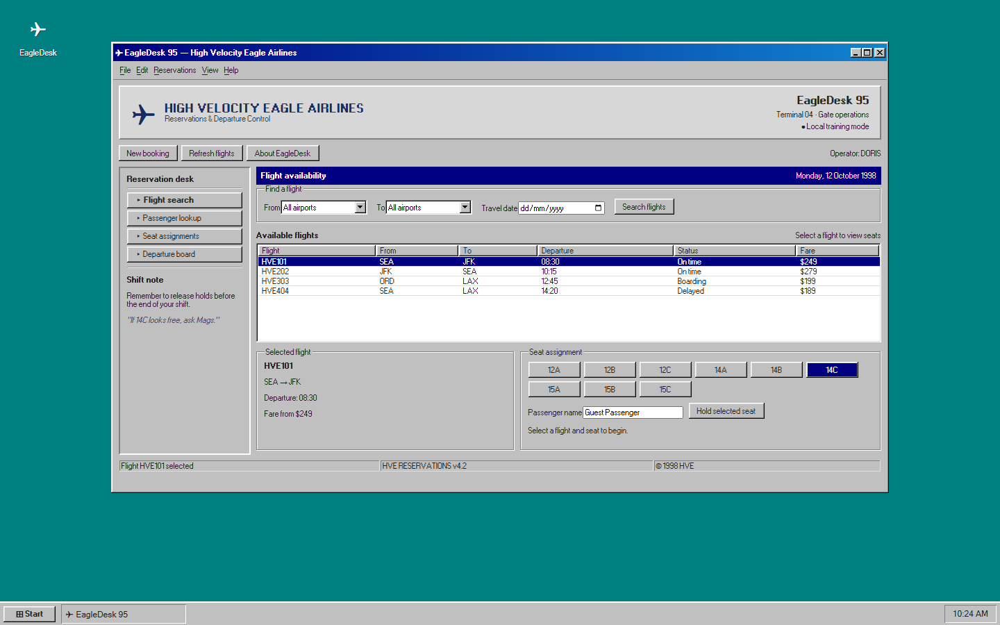
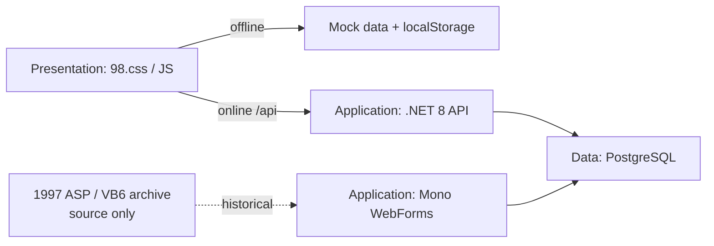
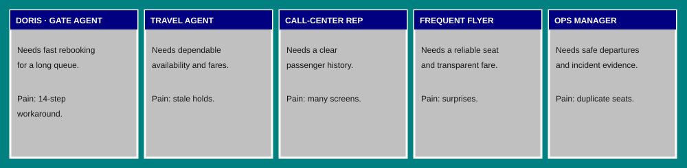
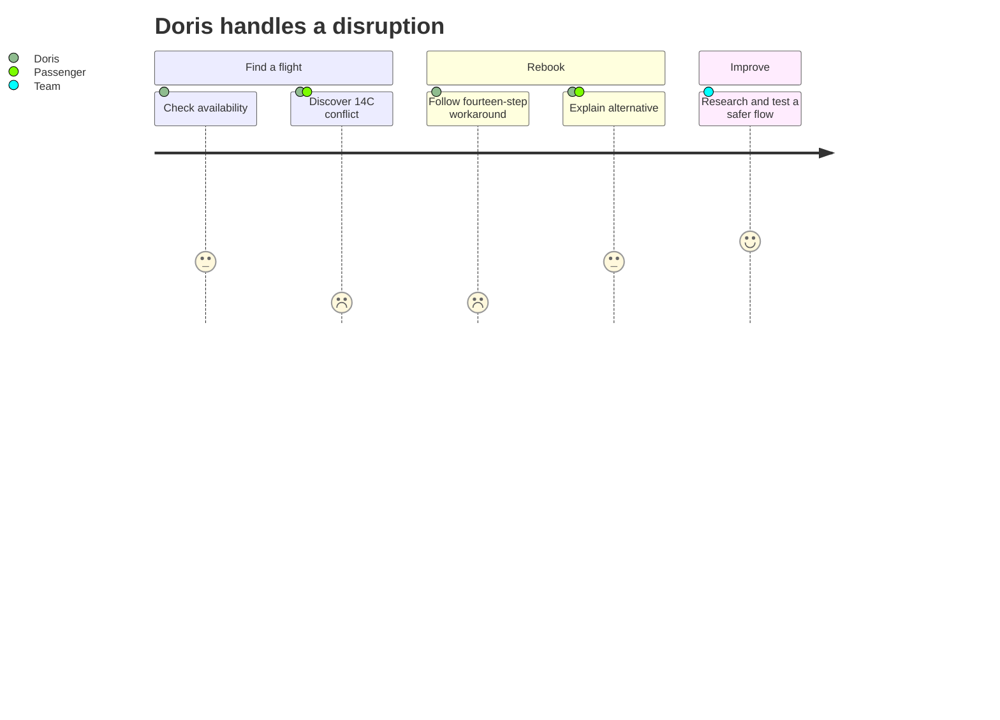
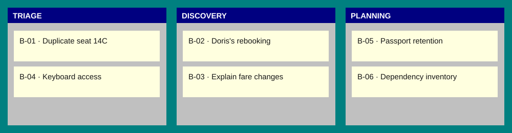

# HVE Core Quests: EagleDesk 95

**High Velocity Eagle Airlines** invites you to investigate a fictional, 30-year-old reservations system. Follow the evidence from the archive to a modern API, and learn HVE Core through twelve quests. This is intentionally flawed training software, **not for production, real passenger data, or public deployment**.



## Start playing

Open `app/web/index.html` directly in a modern browser; no server or installation is required. Search flights, select a row and seat, and hold it locally. Offline holds are stored in that browser's localStorage, not shared with anyone else. For a static server, run `npx serve app/web` and open its local URL; API absence falls back to local mock data. Begin with [The Archivist](quests/01-the-archivist/README.md).

For the optional connected system, install Docker Desktop and run `docker compose -f .devcontainer/docker-compose.yml up --build`; open <http://127.0.0.1:8080/>. The WebForms archive runs at <http://127.0.0.1:8080/webforms/>. Stop with `docker compose -f .devcontainer/docker-compose.yml down`. The `local-demo-only` database password is deliberately public and is for an isolated demo only. A compatible devcontainer host can open `.devcontainer/devcontainer.json`.

### Generate another instance

Install [HVE Core](https://github.com/microsoft/hve-core/blob/main/docs/getting-started/install.md) and make the [legacy-quest-formula](.github/skills/hve-quests/legacy-quest-formula/SKILL.md) skill available to your agent. Generation and checks require PowerShell 7, Node.js 22.14 or newer, npm and Playwright's Chromium browser; simply opening the frontend requires none of these. Invoke `/legacy-quest-formula` with a **required system name** and an empty output directory. Equivalent PowerShell 7 invocation:

```powershell
npm install
npx playwright install chromium
pwsh .github/skills/hve-quests/legacy-quest-formula/scripts/New-QuestInstance.ps1 -SystemName 'EagleDesk 95' -AirlineName 'High Velocity Eagle Airlines' -AirlineCode HVE -OutputPath 'C:\temp\eagle-quest'
```

Non-reference names require Playwright to capture a new screenshot; the title bar, splash and README are customized. The three-letter airline code and airline name are optional. The generator refuses a nonempty destination.

### Validate

```powershell
npm install
npx playwright install chromium
pwsh .github/skills/hve-quests/legacy-quest-formula/scripts/Test-QuestReadiness.ps1
npm run test:ui
npm run test:generator
npm run eval:lint
npm run eval
```

Readiness checks files, clue markers, hashes and generated-instance drift; `test:ui` exercises mock search and local holds and captures the screenshot. Vally lint checks suite structure. `npm run eval` runs response-only smoke probes and requires Copilot SDK model access; even a passing run is **not proof** that a learner completed any quest or that the HVE Core agents were natively invoked. Save and review each quest's requested artifact separately. For a flag, run `pwsh .github/skills/hve-quests/legacy-quest-formula/scripts/Test-QuestFlag.ps1 -Quest 1 -Flag '<value>'`.

## Architecture and time travel



| Era | Layer and evidence |
|---|---|
| 1997 | Classic ASP, VBScript, ActiveX and VB6 COM sources are **inert** historical artifacts; IIS and VB6 are not runtime dependencies. |
| 2003 | C# WebForms on open-source Mono XSP provides a separate historical application surface. |
| 2009 | Globex migrated to PostgreSQL; T-SQL fossils are retained but never executed. The seat hold intentionally has a 14C race. |
| 2019 | A .NET 8 API accesses PostgreSQL; nginx serves the static frontend and proxies the API. |
| 2024 | The CEO's "AI" fare endpoint uses random numbers and rules, not a trained model. |

98.css is MIT; its bundled FontStruction fonts by lou are CC BY-SA 3.0. Notices are in `app/web/vendor/`. PostgreSQL, Mono, .NET, nginx and all listed packages are open source. Image and package versions and their transitive licenses should be reviewed before reuse.

## People, scenarios and backlog

These are fictional personas and scenarios, not validated user research.







## HVE Core Quest

Each badge indicates the area of practice, not a claim of completion. Install the matching HVE Core agents and skills separately; exact availability depends on your HVE Core version.

| Quest | Badge | HVE Core |
|---|---|---|
| [01 The Archivist](quests/01-the-archivist/README.md) | 📚 Docs | Documentation |
| [02 Follow the Seat](quests/02-follow-the-seat/README.md) | 🔎 Research | RPI, rpi-researcher |
| [03 Gate Agent Empathy](quests/03-gate-agent-empathy/README.md) | 💬 Design | DT Coach, UX/UI Designer |
| [04 The CEO's Memo](quests/04-the-ceos-memo/README.md) | 📝 Requirements | Meeting Analyst, BRD Builder, PRD Builder |
| [05 Ticket Counter](quests/05-ticket-counter/README.md) | 🎫 Backlog | Functional Planner, Backlog Manager, Issue Triage, Backlog Grooming |
| [06 Strangler's Gambit](quests/06-stranglers-gambit/README.md) | 🏗️ Architecture | System Architecture Reviewer, ADR Creation |
| [07 Seat 14C](quests/07-seat-14c/README.md) | 🔬 RCA | root-cause-analysis |
| [08 Unlocked Hangar](quests/08-unlocked-hangar/README.md) | 🔒 Security | Security Planner, Security Reviewer |
| [09 Contraband Cargo](quests/09-contraband-cargo/README.md) | 📦 Supply chain | SSSC Planner/Reviewer, Dependency Reviewer |
| [10 Every Passenger](quests/10-every-passenger/README.md) | ♿ Inclusion | Accessibility and Privacy Planner/Reviewer |
| [11 Autopilot Ethics](quests/11-autopilot-ethics/README.md) | ⚖️ Responsible AI | RAI Planner/Reviewer, Experiment Designer |
| [12 Final Approach](quests/12-final-approach/README.md) | 🛬 Delivery | RPI implement, Code Review, pull-request skill, Engagement Report Generator |

The [fictional changelog](docs/lore/CHANGELOG.md), [meeting transcript](docs/lore/ceo-meeting.md), and [backlog](docs/lore/backlog.md) are starting evidence. The flags establish clue discovery, not competency.
