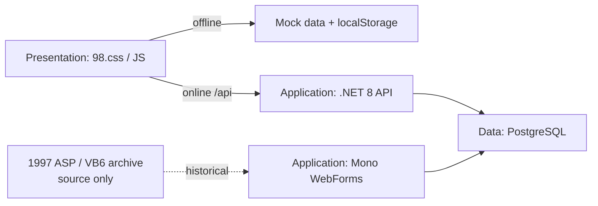
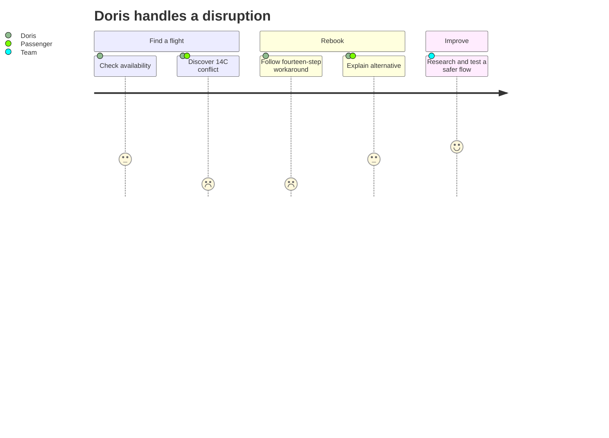

# HVE Core Quests: EagleDesk 95 🦅✈️

Use the **High Velocity Eagle Airlines** exercise formula to investigate a fictional, 30-year-old reservations system. Follow evidence from the archive to a modern API and learn HVE Core through twelve quests. The generated system is intentionally flawed training software, **not for production, real passenger data, or public deployment**. This repository contains the formula and internal support—not a runnable instance.


> This is the existing screenshot from the earlier EagleDesk 95 reference instance. It is an example artifact, not a newly generated runtime or an app included in this repository.

## Start playing

Install [HVE Core](https://github.com/microsoft/hve-core/blob/main/docs/getting-started/install.md). With this repository open in a skill-aware Copilot workspace, the formula is discoverable at `.github/skills/legacy-quest-formula/SKILL.md`; in another workspace, copy that skill directory into its `.github/skills/` directory. Invoke `legacy-quest-formula` with a nonblank `SystemName` and an explicitly selected safe output destination. `AirlineName` and `AirlineCode` are optional; the defaults are High Velocity Eagle Airlines and `HVE`. The generated exercise belongs in that destination, not in this repository.

After generation, follow that output's README for local launch instructions and begin with quest 1 under its `quests/` directory. The offline frontend should work locally without a backend or container. Any optional connected path is generated separately; follow its generated instructions rather than running application commands from this repository.

### Generate another instance

Use the [quest sequence](.github/skills/legacy-quest-formula/references/quest-design.md) and [generated-output layout](.github/skills/legacy-quest-formula/references/output-layout.md) as the formula. Its default exemplar is EagleDesk 95; names remain customizable, while the seat-hold, overbooking, concurrency, and deliberate 14C race scenario stay intact.

### Validate

Repository maintainer checks require Node.js 22.14 or newer and npm for the pinned Vally 0.20.0 dependency, and PowerShell 7 for the output-readiness helpers. These are not requirements for invoking the formula or opening a generated frontend. To run the fixture-based suite:

```shell
npm ci
npm run eval:lint
npm run eval
```

The [internal Vally suite](evals/eagledesk-quests/eval.yaml) has one response-only stimulus per quest, using the fictional Markdown evidence in `docs/lore/`. `eval:lint` checks suite structure; `eval` loads this explicit evaluation file and requires Copilot SDK model access, so probes may be unavailable in some environments. These probes are not checks of a generated app, native HVE execution, or learner competency. For an instance already generated in a separate destination, use the internal helpers:

```powershell
pwsh .github/skills/legacy-quest-formula/scripts/Test-QuestReadiness.ps1 -OutputPath 'C:\path\to\generated-output'
pwsh .github/skills/legacy-quest-formula/scripts/Test-QuestFlag.ps1 -OutputPath 'C:\path\to\generated-output' -Quest 1 -Flag '<value>'
```

They check output structure and clue discovery, not application behavior or learner completion.

## Architecture and time travel

This is the selected downstream exemplar stack; no application layer is built or started here.



| Era | Layer and evidence |
|---|---|
| 1997 | Classic ASP, VBScript, ActiveX and VB6 COM sources are **inert** historical artifacts; IIS and VB6 are not runtime dependencies. |
| 2003 | C# WebForms on open-source Mono XSP provides a separate historical application surface. |
| 2009 | Globex migrated to PostgreSQL; T-SQL fossils are retained but never executed. The seat hold intentionally has a 14C race. |
| 2019 | A .NET 8 API accesses PostgreSQL; nginx serves the static frontend and proxies the API. |
| 2024 | The CEO's "AI" fare endpoint uses random numbers and rules, not a trained model. |

The earlier reference frontend used 98.css (MIT) and FontStruction fonts by lou (CC BY-SA 3.0). Their source files are not included here. Generated output must use open-source components and include applicable notices and attributions. Review image, package, and transitive licenses before reuse.

## People, scenarios and backlog

These are fictional personas and scenarios, not validated user research.





## HVE Core Quest

Each badge indicates the area of practice, not a claim of completion. Install the matching HVE Core agents and skills separately; exact availability depends on your HVE Core version.

| Quest | Badge | HVE Core |
|---|---|---|
| 01 The Archivist | 📚 Docs | Documentation |
| 02 Follow the Seat | 🔎 Research | RPI, rpi-researcher |
| 03 Gate Agent Empathy | 💬 Design | DT Coach, UX/UI Designer |
| 04 The CEO's Memo | 📝 Requirements | Meeting Analyst, BRD Builder, PRD Builder |
| 05 Ticket Counter | 🎫 Backlog | Functional Planner, Backlog Manager, Issue Triage, Backlog Grooming |
| 06 Strangler's Gambit | 🏗️ Architecture | System Architecture Reviewer, ADR Creation |
| 07 Seat 14C | 🔬 RCA | root-cause-analysis |
| 08 Unlocked Hangar | 🔒 Security | Security Planner, Security Reviewer |
| 09 Contraband Cargo | 📦 Supply chain | SSSC Planner/Reviewer, Dependency Reviewer |
| 10 Every Passenger | ♿ Inclusion | Accessibility and Privacy Planner/Reviewer |
| 11 Autopilot Ethics | ⚖️ Responsible AI | RAI Planner/Reviewer, Experiment Designer |
| 12 Final Approach | 🛬 Delivery | RPI implement, Code Review, pull-request skill, Engagement Report Generator |

The full sequence and objectives are in the [formula's quest design](.github/skills/legacy-quest-formula/references/quest-design.md); generated briefs live only in the selected output destination under `quests/01-*` through `quests/12-*`. The [fictional changelog](docs/lore/CHANGELOG.md), [meeting transcript](docs/lore/ceo-meeting.md), and [backlog](docs/lore/backlog.md) are internal evidence fixtures for the maintainer suite. Generated flags establish clue discovery, not competency.
