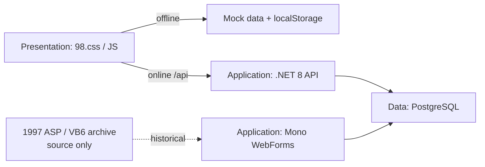
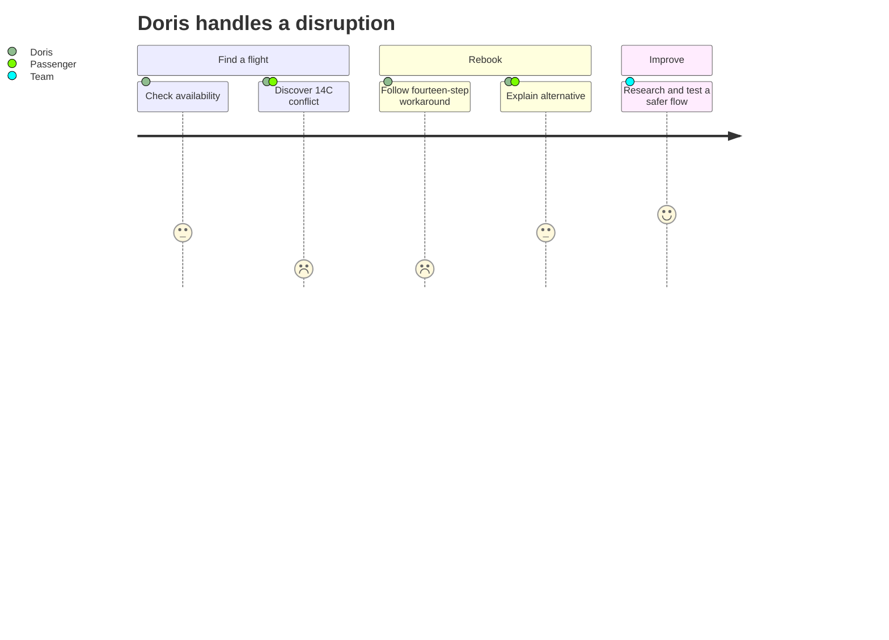

# HVE Core Quests

### A reusable formula for fictional legacy-modernization exercises

Generate a self-contained, offline-first training playground and a connected sequence of twelve HVE Core quests. The default story follows **EagleDesk 95**, a fictional airline reservation system with a deliberate seat-14C race.

| **This repository** | **Your generated playground** | **Training data** |
| --- | --- | --- |
| The formula skill and maintainer evaluation support | Created in a separate, explicitly selected destination | Fictional only; never use real passenger data |

> **Not a booking system.** The generated exercise is intentionally flawed training software. Keep it local and isolated; do not deploy it publicly or present it as production-ready. This repository contains the formula and internal support, not a runnable generated instance.

<details>
<summary>Preview an earlier EagleDesk reference (not generated by this repository)</summary>


This archived screenshot illustrates an earlier reference instance. It is not a screenshot of a newly generated playground or the current formula output.

</details>

## Generate a playground

1. [Install HVE Core](https://github.com/microsoft/hve-core/blob/main/docs/getting-started/install.md).
2. Open this repository in a skill-aware Copilot workspace.
3. Invoke `legacy-quest-formula` with a nonblank `SystemName` and an explicitly selected safe output destination.
4. Open the generated `README.md`, launch its offline frontend, and begin with quest 1.

The skill is at [`.github/skills/legacy-quest-formula/SKILL.md`](.github/skills/legacy-quest-formula/SKILL.md). In another workspace, copy the `legacy-quest-formula` skill directory into that workspace's `.github/skills/` directory before invoking it.

| Input | Default or requirement |
| --- | --- |
| `SystemName` | Required and nonblank; defaults to EagleDesk 95 in the formula. |
| `output` | Required; explicitly choose a safe, new or empty destination outside this repository. |
| `AirlineName` | Optional; defaults to High Velocity Eagle Airlines. |
| `AirlineCode` | Optional; defaults to `HVE`; supplied codes must be three uppercase letters. |

The generated frontend should work locally without a backend, network, or container. Optional connected components are separate; use the generated instructions for those paths rather than running application commands from this formula repository.

### Adapt the exercise

Use the [quest sequence](.github/skills/legacy-quest-formula/references/quest-design.md) and [generated-output layout](.github/skills/legacy-quest-formula/references/output-layout.md) as the formula. Names can change; the seat-hold, overbooking, concurrency, and deliberate 14C race scenario remain part of the default exemplar.

## Validate

Maintainer checks require **Node.js 22.14 or newer**, **npm**, and **PowerShell 7** for the output-readiness helpers. These tools are not required to invoke the formula or open a generated frontend.

Run the repository's fixture-based Vally suite:

```shell
npm ci
npm run eval:lint
npm run eval
```

The [internal Vally suite](evals/eagledesk-quests/eval.yaml) has one response-only stimulus per quest, using fictional Markdown evidence in `docs/lore/`. `eval:lint` checks suite structure. `eval` loads this explicit evaluation file and requires Copilot SDK model access, so probes may be unavailable in some environments. These probes are not checks of a generated app, native HVE execution, or learner competency.

For an instance generated in a separate destination, run the internal helpers with its path:

```powershell
pwsh .github/skills/legacy-quest-formula/scripts/Test-QuestReadiness.ps1 -OutputPath 'C:\path\to\generated-output'
pwsh .github/skills/legacy-quest-formula/scripts/Test-QuestFlag.ps1 -OutputPath 'C:\path\to\generated-output' -Quest 1 -Flag '<value>'
```

These scripts check output structure and clue discovery, not application behavior or learner completion.

## Example system: layers and eras

The diagram is a selected downstream exemplar stack. No application layer is built or started in this repository.



| Era | Layer and evidence |
| --- | --- |
| **1997** | Classic ASP, VBScript, ActiveX, and VB6 COM sources are inert historical artifacts; IIS and VB6 are not runtime dependencies. |
| **2003** | C# WebForms on open-source Mono XSP provides a separate historical application surface. |
| **2009** | Globex migrated to PostgreSQL; T-SQL fossils are retained but never executed. The seat hold intentionally has a 14C race. |
| **2019** | A .NET 8 API accesses PostgreSQL; nginx serves the static frontend and proxies the API. |
| **2024** | The CEO's "AI" fare endpoint uses random numbers and rules, not a trained model. |

The earlier reference frontend used 98.css (MIT) and FontStruction fonts by lou (CC BY-SA 3.0); their source files are not included here. Generated output must use open-source components and include applicable notices and attributions. Review image, package, and transitive licenses before reuse.

## People, scenarios, and backlog

Personas and scenarios are fictional, not validated user research.





## Twelve-quest map

Each badge indicates an area of practice, not a claim of completion. Install matching HVE Core agents and skills separately; exact availability depends on your HVE Core version.

| Quest | Badge | HVE Core practice |
| --- | --- | --- |
| **01 The Archivist** | 📚 Docs | Documentation |
| **02 Follow the Seat** | 🔎 Research | RPI, `rpi-researcher` |
| **03 Gate Agent Empathy** | 💬 Design | DT Coach, UX/UI Designer |
| **04 The CEO's Memo** | 📝 Requirements | Meeting Analyst, BRD Builder, PRD Builder |
| **05 Ticket Counter** | 🎫 Backlog | Functional Planner, Backlog Manager, Issue Triage, Backlog Grooming |
| **06 Strangler's Gambit** | 🏗️ Architecture | System Architecture Reviewer, ADR Creation |
| **07 Seat 14C** | 🔬 RCA | `root-cause-analysis` |
| **08 Unlocked Hangar** | 🔒 Security | Security Planner, Security Reviewer |
| **09 Contraband Cargo** | 📦 Supply chain | SSSC Planner/Reviewer, Dependency Reviewer |
| **10 Every Passenger** | ♿ Inclusion | Accessibility and Privacy Planner/Reviewer |
| **11 Autopilot Ethics** | ⚖️ Responsible AI | RAI Planner/Reviewer, Experiment Designer |
| **12 Final Approach** | 🛬 Delivery | RPI implement, Code Review, pull-request skill, Engagement Report Generator |

Read the [full quest sequence and objectives](.github/skills/legacy-quest-formula/references/quest-design.md). Generated briefs live only in the selected output destination under `quests/01-*` through `quests/12-*`. The [fictional changelog](docs/lore/CHANGELOG.md), [meeting transcript](docs/lore/ceo-meeting.md), and [backlog](docs/lore/backlog.md) are internal evidence fixtures for the maintainer suite. Generated flags establish clue discovery, not competency.
