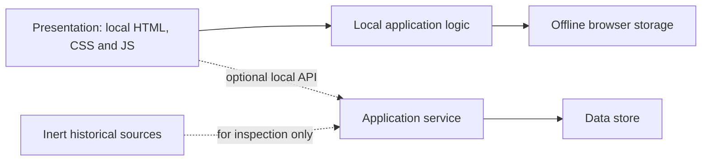

# HVE Core Quests

This repository contains **workshop instructions**, not a sample dataset or a runnable application. Twelve quests teach people to investigate and modernize a legacy reservation system. A separately created playground runs locally; neither the playground nor its screenshots belong in the public instruction set.

## Start here: instruction-only workshop

No model, sign-in, installation, or sample data is needed. Read the [quest sequence and HVE practice map](.github/skills/legacy-quest-formula/SKILL.md#twelve-quest-sequence) in order. Start with **01 Documentation**: draw the boundary between the offline frontend and an optional service, then write a launch note that explains what does *not* need to be running. For later quests, work from the objectives: sketch a research plan, identify assumptions, or draft acceptance criteria. Mark missing observations as unknown rather than inventing evidence.

| Quest | Practice | Instruction-only activity |
|---|---|---|
| 01 | Documentation | Explain the offline launch in your own words. |
| 02 | Research | List the observations needed to trace a seat hold. |
| 03 | User empathy and design | Identify assumptions that would need validation with users. |
| 04 | Requirements | Define an observable outcome and an open question. |
| 05 | Backlog planning | Order the investigation tasks by their prerequisites. |
| 06 | Architecture and ADR | Compare two ways to separate the frontend from the service. |
| 07 | Root cause | Describe a comparison that could distinguish two explanations. |
| 08 | Security | Mark a trust boundary on the architecture diagram and explain a control. |
| 09 | Supply chain | List what you would check before accepting a dependency. |
| 10 | Accessibility and privacy | Plan a keyboard-only walkthrough and a data-minimization check. |
| 11 | Responsible AI and experiments | Define a measure and a stopping condition before an experiment. |
| 12 | Implementation, review and reporting | Draft acceptance criteria and distinguish planned work from observed results. |

## Local playground: only after eligibility is established

Before opening a model session, consult your organization's accountable owner and approved tooling for this *particular* local workshop, source class, effective model and service, including fallback. If these cannot be verified, use the instruction-only path above. A sign-in, preferred model, public repository, license, or claim that material is fictional does not establish eligibility. Teaching participants is not training a model.

1. [Install HVE Core](https://github.com/microsoft/hve-core/blob/main/docs/getting-started/install.md) if you will use its tools. Use an eligible, clean skill-aware workspace with only the [formula directory](.github/skills/legacy-quest-formula/) installed under `.github/skills/`. Do not attach files or open a workspace containing example material in the model context.
2. Invoke [legacy-quest-formula](.github/skills/legacy-quest-formula/SKILL.md) with a short, newly invented `SystemName` and an explicitly chosen new or empty local output directory outside the formula repository. `AirlineName` and a three-uppercase-letter `AirlineCode` are optional invented labels. These are labels, not descriptions or fields for pasting a sample. No seeded mode exists, including for maintainers.
3. In the new destination, open `app/web/index.html` directly in a browser. No backend, container, network or npm installation is needed for the frontend. Follow the generated `README.md` link to quest 01. Any connected stack has separate local setup instructions.
4. Capture the **new local interface** for the generated guide, excluding other windows and personal information. Store it only in the destination and record its origin alongside the other artifacts. Do not use an archived image or attach the capture to a public branch, issue or workshop handout.



The [source and interface contract](.github/skills/legacy-quest-formula/SKILL.md#checkpoint-2-executable-source-and-truthful-evidence) describes the battleship-gray Windows 95 airline business app: dense panes, inset fields and beveled controls, without an imitation Start button or taskbar. See the [output contract](.github/skills/legacy-quest-formula/SKILL.md#output-contract) for paths, actual screenshots and provenance requirements. The [safety gate](.github/skills/legacy-quest-formula/SKILL.md#safety-gate) distinguishes local creation, evaluation, cross-team reuse and external distribution. Obtain a separate decision and agreed disclosure for any sample distribution **before** sharing, including a public commit. A fictional-use label is not release approval.

## Customer pack and author workbench

Copy only `.github/skills/legacy-quest-formula/` into a clean eligible workspace. Its complete distributable is **four files**:

| File in the skill folder | Purpose |
|---|---|
| `SKILL.md` | Self-contained generation prompt, safeguards, output contract and twelve quests. |
| `scripts/Test-QuestReadiness.ps1` | Deterministic local structural check, copied unchanged into the new output. |
| `scripts/Test-QuestFlag.ps1` | Deterministic discovery check, copied unchanged into the new output. |
| `LICENSE` | MIT notice copied with the checkers. |

The scripts avoid generating different validation rules for every customer; there is no reference app or sample data to install. The generated repository will have its own app, docs, quests and local checks, created in the separate destination. Those output files are not part of the distributed pack.

Everything outside the skill folder is repository metadata, documentation or the **author-only workbench**. Customers do not need root `package.json`/lockfile, `tests/`, `scripts/eval-preflight.cjs`, `evals/` or author evidence to generate the exercise. The generation procedure must not consult those files as examples.

## Maintainer checks

From this repository, use Node.js 22.14 or newer, npm, and PowerShell 7. The frontend itself needs none of these tools.

```shell
npm ci
npm run eval:lint
npm test
```

`eval:lint` validates the [twelve procedural Vally cases](evals/eagledesk-quests/eval.yaml) without running probes. `npm test` exercises safeguards offline. The supported `npm run eval` entry **stops before model contact**: no trusted binding establishes the effective service/model and fallback for this executor. No environment switch enables it. Do not stage old fixtures or run a runner directly as a substitute.

To inspect a separately generated local output:

```powershell
$out = 'C:\path\to\your\local-output'
pwsh .github/skills/legacy-quest-formula/scripts/Test-QuestReadiness.ps1 -OutputPath $out
pwsh .github/skills/legacy-quest-formula/scripts/Test-QuestFlag.ps1 -OutputPath $out -Quest 1 -Flag '<local-clue-value>'
```

The [validation checkpoint](.github/skills/legacy-quest-formula/SKILL.md#checkpoint-4-static-validation-and-offline-observation) explains what these results mean. Missing provenance in an older output means origin unknown; do not reconstruct it to make a check pass.

Author regressions check the exact four-file boundary, self-contained links, retained safety/quest contracts, unique static grader names and checker behavior from an isolated pack. They do not prove that a new generation obeys the prompt. Historical suites that failed before executing probes provide no model-quality score. Matched fresh-generation comparisons and native HVE walkthroughs need independently verified clean context and an approved use/route; the current live-evaluation entry remains disabled. Report artifact results, native workflow status, human approvals and runtime observations separately rather than claiming the checks guarantee a completed HVE lifecycle.

The [MIT license](LICENSE) covers this software. Earlier versions credited 98.css (MIT) and FontStruction fonts by lou (CC BY-SA 3.0); those assets are not included in this instruction tree. Retain applicable third-party notices in any output that uses the corresponding components.
